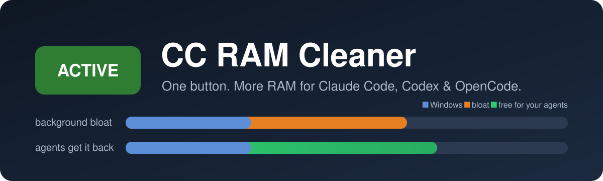
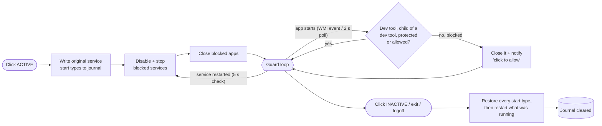

<p align="center">
  
</p>

<p align="center">
  <b>Run more AI coding agents on the laptop you already have.</b><br>
  One button stops the background bloat eating your RAM, keeps it from coming back,<br>
  and never touches your dev tools. Turn it off and Windows is exactly as it was.
</p>

<p align="center">
  <a href="../../releases/latest"></a>
</p>

<p align="center">
  <a href="https://github.com/oktayparlak/cc-ram-cleaner/actions/workflows/ci.yml"></a>
  <a href="https://github.com/oktayparlak/cc-ram-cleaner/stargazers"></a>
  
  
  
  
</p>

---

## Why this exists

Every Claude Code, Codex or OpenCode terminal is a real process with its own memory, and the
real fun starts when you run four or five of them in parallel next to Docker, an Android
emulator and Chrome.

On the 16 GB laptop this tool was built on, with five Claude Code sessions open, Windows showed
**1.5 GB available (10 %)**. Meanwhile Spotify alone was holding ~600 MB, and game launchers,
OEM "command centers", telemetry services, updaters, widgets and chat apps were sitting in the
background doing nothing useful for the work at hand.

Closing them by hand doesn't last: launchers restart themselves, services come back at the next
trigger, and you have to remember to turn everything back on later.

**CC RAM Cleaner turns that into one button.**

## What it does

| | |
|---|---|
| 🟢 **One toggle** | Click **ACTIVE**: blocklisted services are disabled and stopped, blocklisted apps are closed. Click again: every service goes back to its exact original state. |
| 🛡️ **Keeps them gone** | While active, a WMI process-start watcher (plus a 2-second safety poll) closes blocked apps the moment they relaunch, and a 5-second check stops services that Windows restarts. |
| 🧑‍💻 **Dev tools are sacred** | Claude Code, Codex, OpenCode, Node, Python, Java, .NET, Git, terminals, WSL, Docker, Android emulator, Chrome/Edge/Firefox, VS Code, Cursor, Windsurf, JetBrains IDEs… are never touched. Neither is anything they spawn (`git-credential-manager`, `esbuild`, `testhost`, `rg`, …). |
| 📊 **Live dashboard** | Total / available RAM, how much was reclaimed, and how many **Claude Code, Codex and OpenCode** sessions are open (only the agents you're actually running are listed). |
| 🔍 **Preview first** | See exactly which apps and services would be stopped, and the estimated gain, before you press anything. |
| 🧹 **Extra squeeze** | Optionally trims the working set of idle processes every 60 s and purges the standby cache when RAM gets low. |
| 💡 **Suggestions** | Lists the unknown apps currently running, sorted by memory, with one-click *Block* / *Allow*. |
| ↩️ **Crash-safe** | Every service change is written to a journal *before* it happens. If the app is killed, the PC crashes or you log off, the next start puts everything back. |

## Two profiles

| | **Balanced** (default) | **Aggressive** |
|---|---|---|
| Idea | Block a curated list of known bloat | Only Windows, security software and dev tools may run in your session |
| Apps closed | Spotify, Discord, Steam, Epic, Riot, Battle.net, OneDrive, Teams, NVIDIA overlay, OMEN Gaming Hub, Phone Link, Widgets, Xbox Game Bar, Copilot, Adobe CC helpers, iCUE, Razer, Armoury Crate, G HUB, Overwolf… | All of Balanced **plus every unknown app in your session** |
| Services disabled | Telemetry (DiagTrack), error reporting, Search indexer, SysMain, Xbox, Edge/Google updaters, HP analytics, Adobe updater, Steam… (same in both profiles) | same |
| Your open work | — | Apps that already have an open window when you activate are left alone (no lost unsaved work). New launches are blocked; click the notification to allow one permanently. |

Every default rule can be switched off, and you can add your own apps (with `*` wildcards) and services.

<details>
<summary><b>Full default lists</b></summary>

The single source of truth is [`rules.default.json`](src/CCRamCleaner.Core/Rules/rules.default.json):
`blockedServices`, `blockedProcesses` (both with an on/off default per entry) and `devAllowedProcesses`.
Print Spooler and the NVIDIA display container are included but **off by default**.

</details>

## How it works



## Safety first

This tool runs as administrator and stops things on purpose, so it is built to fail safe:

- **Never touched, no matter what:** Windows core processes (csrss, lsass, dwm, explorer, svchost, …),
  processes Windows marks as critical, processes it cannot inspect (protected/anti-malware),
  Windows Defender, Kaspersky, ESET, Bitdefender, Avast/AVG, Task Manager, UAC prompts, and the app itself.
- **Exact-process kills only:** a process is identified by its PID *and* creation time, so a recycled PID
  can never take down an unrelated process. Process trees are never killed wholesale.
- **Services only from the list:** no profile ever stops a service that isn't on the block list.
- **Write-ahead journal:** original start types are persisted (and flushed to disk) before any change.
  If the journal can't be written, nothing is changed. Restores write all start types back first,
  so even an interrupted restore leaves Windows correct.
- **Locked-down state folder:** `%ProgramData%\CCRamCleaner` is created Administrators/SYSTEM-only and
  rejected if it is a junction or owned by someone else.
- **Logoff / shutdown aware:** start types are restored when your session ends.
- **"Start with Windows"** uses a Task Scheduler task that is not stopped on battery or after 72 hours.

## Install

1. Download from [**Releases**](../../releases/latest):
   - `CCRamCleaner-win-x64.exe` — small, needs the [.NET 10 Desktop Runtime](https://dotnet.microsoft.com/download/dotnet/10.0)
   - `CCRamCleaner-win-x64-selfcontained.exe` — larger, no runtime needed
2. Run it and accept the administrator prompt (needed to stop services and other apps' processes).
3. Press **Preview**, check the list, then press **ACTIVE**.

> Windows SmartScreen may warn about an unsigned download. The source is right here; you can also
> build it yourself in one command (see below).

## FAQ

<details>
<summary><b>Will this break Windows Update or my antivirus?</b></summary>

No. Windows Update (`wuauserv`), Defender and the other listed security products are not on any list,
and security processes are hard-protected. Only the Edge and Google *browser updaters* are paused while active.
</details>

<details>
<summary><b>How do I undo everything?</b></summary>

Click the button again, or exit from the tray. If the app ever died while active, just start it again:
it restores the services from its journal before doing anything else.
</details>

<details>
<summary><b>Does it kill my terminals or agents?</b></summary>

No. Terminals, shells, WSL, Docker and the agents themselves are on the dev allow list, and in
Aggressive mode anything started *by* a dev tool inherits that protection. You can add your own tools
to the allow list from the **Rules** tab or straight from a notification.
</details>

<details>
<summary><b>Why does it need administrator rights?</b></summary>

Changing a service's start type, stopping services and closing processes started by other
programs all require elevation. The app does nothing outside the lists you can see in the UI.
</details>

<details>
<summary><b>Is the "Reclaimed" number real?</b></summary>

It is the working set of the apps and (own-process) services it stopped, plus what idle trimming released.
Purging the standby cache is deliberately *not* counted, because Windows already reports standby memory as available.
</details>

## Build from source

Requires the [.NET 10 SDK](https://dotnet.microsoft.com/download/dotnet/10.0) on Windows.

```bash
git clone https://github.com/oktayparlak/cc-ram-cleaner.git
cd cc-ram-cleaner
dotnet test CCRamCleaner.slnx
dotnet publish src/CCRamCleaner.App -c Release -r win-x64 -p:PublishSingleFile=true --self-contained false -o publish
```

Project layout:

| Path | What's inside |
|---|---|
| `src/CCRamCleaner.Core` | UI-free engine: rules, classifier, guard state machine, journal, Win32/WMI/SCM wrappers |
| `src/CCRamCleaner.App` | WPF shell: toggle, dashboard, rules, suggestions, settings, tray |
| `tests/CCRamCleaner.Core.Tests` | 100+ xUnit tests (fakes for the logic, real Windows for the integration layer) |
| `docs/superpowers` | The original design spec and implementation plan |

## Contributing

Issues and pull requests are welcome, especially:

- **Rules:** bloat you'd like blocked by default, or dev tools that should be on the allow list
  (edit `rules.default.json`; tests check that no blocked app is also a dev tool).
- **Translations:** UI strings live in one file, `src/CCRamCleaner.App/L.cs` (English and Turkish today).

Please run `dotnet test` before opening a PR.

## License

[MIT](LICENSE). CC RAM Cleaner is an independent open-source project and is not affiliated with
Anthropic, OpenAI or the OpenCode project.

<p align="center"><b>If it gave your agents room to breathe, a ⭐ helps other developers find it.</b></p>

---

## 🇹🇷 Türkçe

**CC RAM Cleaner**, Windows'ta Claude Code, Codex ve OpenCode gibi AI kodlama ajanlarına RAM açan
tek butonlu bir araçtır.

- **AKTİF** yapınca gereksiz servisleri (telemetri, güncelleyiciler, Xbox, OEM yardımcıları…) kapatır,
  gereksiz uygulamaları (Spotify, Discord, oyun başlatıcıları, Teams, OneDrive…) sonlandırır ve
  **geri açılmalarını engeller.**
- Dev araçlarına ve onların başlattığı süreçlere **asla dokunmaz:** terminaller, WSL, Docker,
  Android emülatörü, Chrome, IDE'ler, Node/Python/Java/.NET ve ajanların kendisi.
- **PASİF** yapınca tüm servisler eski haline döner. Uygulama çökse bile bir sonraki açılışta
  geri yüklenir.
- **Panel:** toplam/kullanılabilir RAM, kazanılan bellek ve açık Claude Code / Codex / OpenCode oturumları
  (yalnızca açık olanlar gösterilir).
- **Dengeli** profil bilinen gereksizleri, **Agresif** profil dev araçları dışındaki her şeyi engeller.
  Agresif açıldığında penceresi açık uygulamalar kaydedilmemiş iş kaybolmasın diye kapatılmaz.
- **Önizle** ile neyin duracağını önceden görebilir, kuralları ve önerileri tek tıkla düzenleyebilirsin.

İndirmek için [**Releases**](../../releases/latest) sayfasına git. Faydalı bulduysan ⭐ vermeyi unutma!
